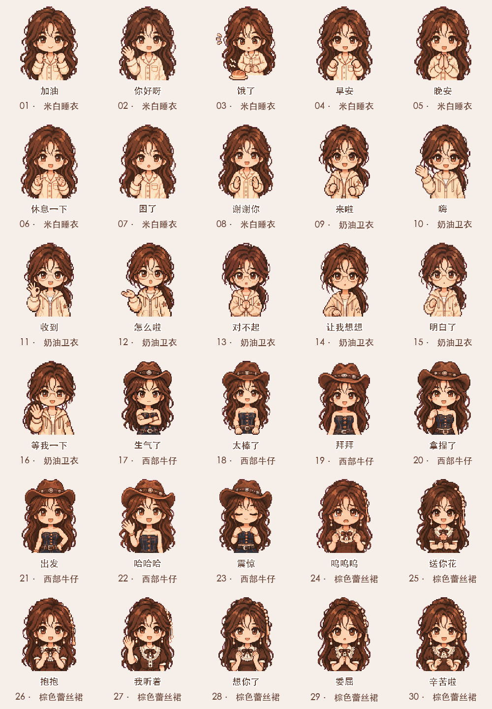

# 林知夏 · Q版表情衣橱

原创虚构角色「林知夏」的多穿搭像素Q版表情作品库。

**当前版本：4套穿搭、30款表情，每款包含透明循环GIF和静态PNG。**

## 系列

| 穿搭 | 数量 | 主要表情 |
|---|---:|---|
| [米白睡衣](packs/cream-pajamas/) | 8 | 你好呀、加油、早安、晚安、困了、饿了、休息一下、谢谢你 |
| [奶油卫衣](packs/cream-hoodie/) | 8 | 嗨、收到、明白了、等我一下、来啦、让我想想、怎么啦、对不起 |
| [西部牛仔](packs/western-denim/) | 7 | 出发、拿捏了、太棒了、哈哈哈、震惊、生气了、拜拜 |
| [棕色蕾丝裙](packs/brown-lace/) | 7 | 抱抱、想你了、委屈、呜呜呜、送你花、辛苦啦、我听着 |

## 下载与浏览

- [下载30款GIF与PNG](downloads/stickers-30.zip)
- 下载仓库后打开 `index.html`，可离线按穿搭筛选、预览并保存单张表情。
- [6秒动态视频预览](catalog/preview-30.mp4)
- [静态总览](catalog/preview.png) · [机器可读清单](catalog/stickers.json)
- [77条穿搭候选目录](catalog/outfits.json)，候选不表示已生成。原始人物参考、语音和视频保留在本地。

## 制作与验证

基于所有者提供的角色、穿搭参考，使用内置AI图像工具为每款生成独立四帧动作图集；经过背景清理、帧对齐、中文排版，导出320×320透明循环GIF，每轮约1.2秒。不是模型直接输出GIF。AI生成帧之间可能存在细节轻微变化。

`packs/<穿搭>/`包含GIF、PNG、连续帧及生成图集；`sources/`记录新增款的生成提示词。运行 `python3 scripts/export_gifs.py` 可从已审查的RGBA连续帧重新导出，依赖Pillow。

每款已检查数量、配字唯一性、4帧可解码、可见帧变化、循环标记、透明背景和边缘留白；下载包通过ZIP完整性检查。此版本不以某个聊天平台的上传规格为验收目标。

## 权利与使用

本仓库公开用于作品展示与版本管理。角色及美术素材相关权利由权利人保留；未授予商用、二次分发、改编或模型训练许可，需要使用请联系仓库所有者。公开访问不等于开源授权。

人物由仓库所有者声明为自有角色；本项目使用AI辅助创作。未复制参考项目的代码或人物素材。
