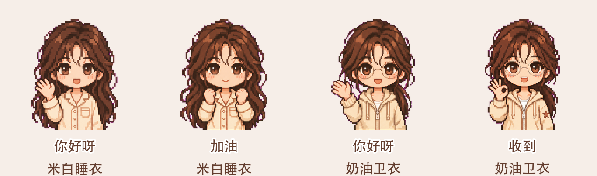

# 林知夏 · Q版表情衣橱

以原创虚构角色「林知夏」的不同穿搭为灵感，持续制作像素Q版聊天表情。

## 当前系列

| 系列 | 已完成 | 动态预览 |
|---|---|---|
| [米白睡衣](packs/cream-pajamas/) | 你好呀、加油 |  |
| [奶油卫衣](packs/cream-hoodie/) | 你好呀、收到 |  |

首批共 **2套穿搭、4款动态样稿**。图为像素Q版设计，尚非完整16款套装。每款包含透明GIF、静态PNG、连续帧及生成图集。

## 下载与浏览

[下载首批4款GIF与PNG](downloads/starter-pack.zip)。GitHub会直接播放上面的GIF，也可以下载后本地查看。

[穿搭候选目录](catalog/outfits.json)记录现有素材的分类和名称。原始人物照片式参考、语音和视频保留在本地，不随仓库公开。

## 制作方式

人物与穿搭参考由仓库所有者提供，图像使用内置AI图像工具生成；四格连续动作经背景清理、帧对齐、文字排版后合成透明GIF。本批不是模型直接输出GIF，也不是仅把静态图片整体摇动。

角色固定特征：深棕发、空气刘海、棕眼与温柔气质。穿搭系列可改变服饰、发型和参考图中已有配饰。每次新增系列需检查动作、透明边缘、文字、循环及人物一致性。

## 后续扩展

按「穿搭系列 → 表情 → GIF / PNG / 连续帧」保存。优先补齐每套的问候、回复、情绪和陪伴动作，再扩展秋冬、古装、礼服等穿搭；候选目录不表示对应系列已经生成。

## 权利与使用

本仓库公开用于作品展示与版本管理。角色及美术素材相关权利由权利人保留；未授予商用、二次分发、改编或模型训练许可。需要使用请通过仓库联系所有者。公开访问不等于开源授权。

AI辅助生成记录不构成权属登记或第三方不侵权保证。本仓库未复制参考项目的代码或人物素材。
