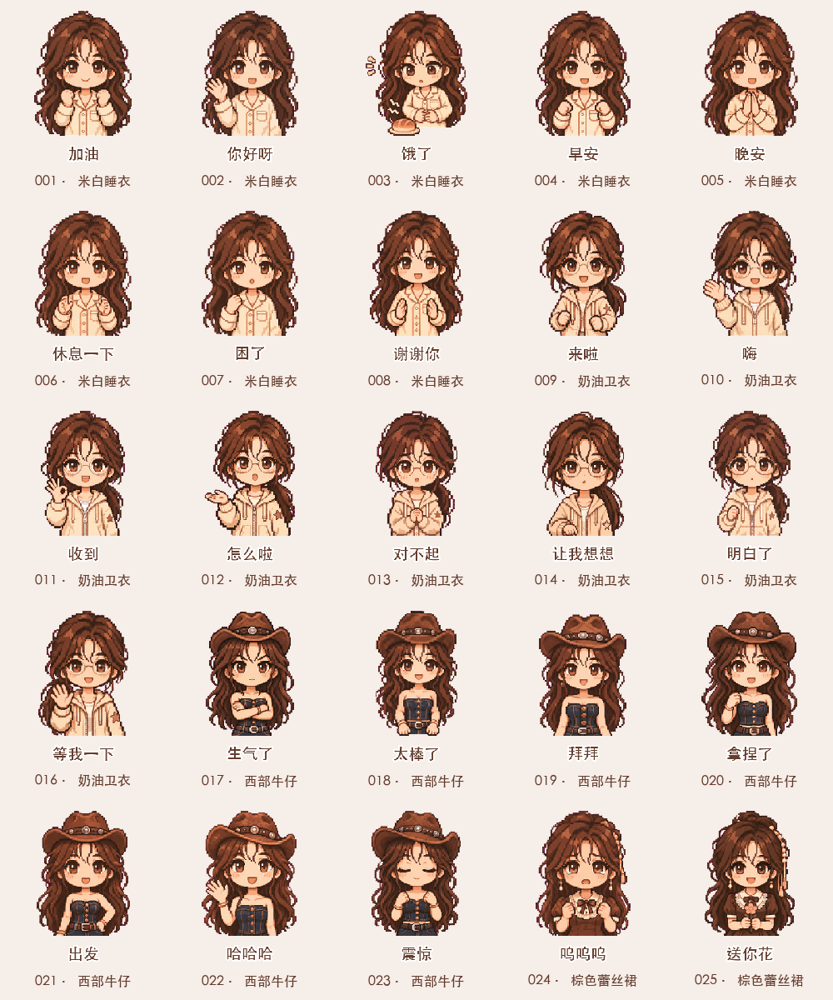
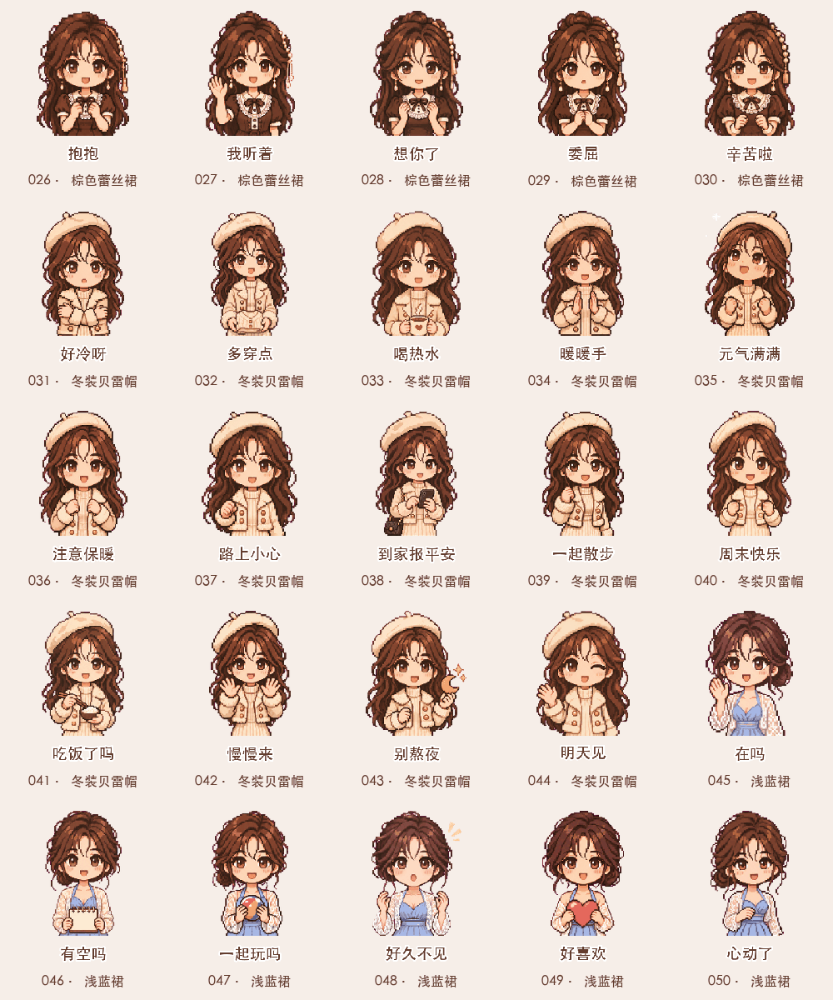
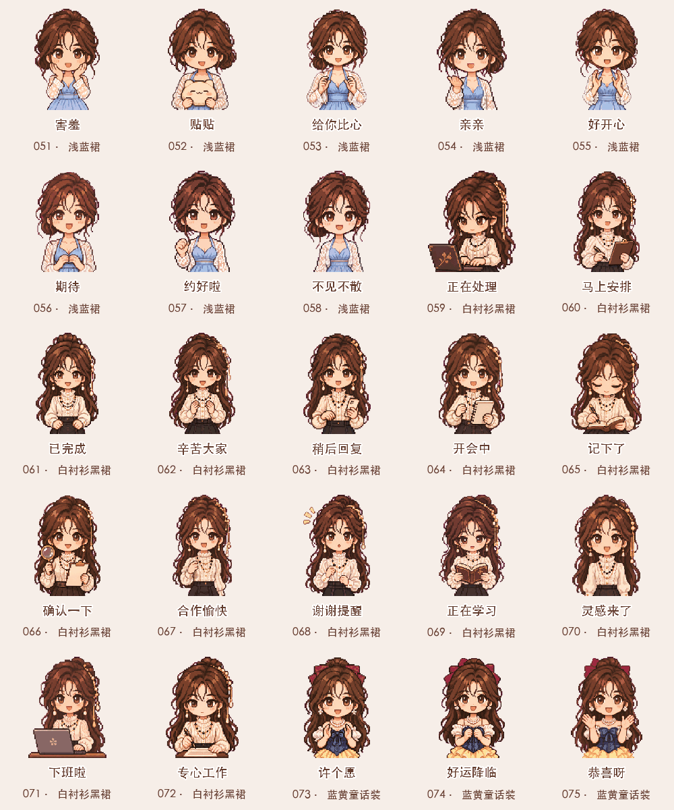
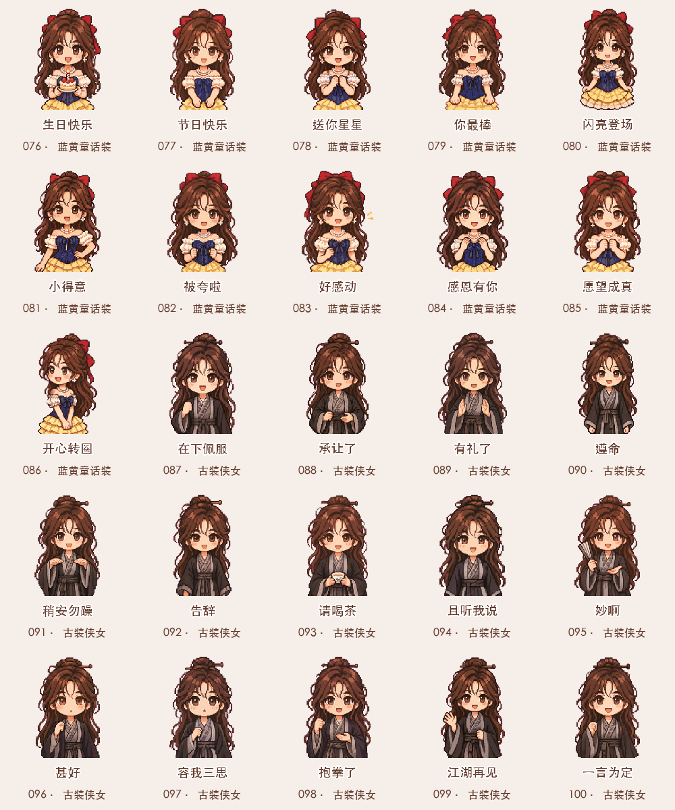

# 林知夏 · Q版表情衣橱

原创虚构角色「林知夏」的多穿搭像素Q版表情作品库。

**当前版本：9套穿搭、100款表情。每款包含320×320透明循环GIF及静态PNG。**

[下载完整100款](downloads/stickers-100.zip) · 下载仓库后打开 `index.html`，按穿搭筛选或搜索配字，离线浏览及保存。

## 穿搭系列

| 系列 | 数量 |
|---|---:|
| [米白睡衣](packs/cream-pajamas/) | 8 |
| [奶油卫衣](packs/cream-hoodie/) | 8 |
| [西部牛仔](packs/western-denim/) | 7 |
| [棕色蕾丝裙](packs/brown-lace/) | 7 |
| [冬装贝雷帽](packs/winter-beret/) | 14 |
| [浅蓝裙](packs/blue-dress/) | 14 |
| [白衬衫黑裙](packs/white-blouse/) | 14 |
| [蓝黄童话装](packs/fairytale/) | 14 |
| [古装侠女](packs/hanfu/) | 14 |

## 动态预览

每页25款；点击图片可查看原尺寸。

[100款静态总览](catalog/preview-100.png) · [动态视频预览](catalog/preview-100.mp4) · [完整清单](catalog/stickers.json) · [微信配套图片](assets/wechat-pixel/)

## 制作方式

基于所有者提供的角色及穿搭参考，使用内置AI图像工具为每款生成独立四帧动作图集，经背景清理、帧对齐和中文排版后合成透明GIF，每轮约1.2秒。不是模型直接生成GIF。帧间可能有AI生成的轻微细节变化。

每款均有独立动作与唯一配字。目录 `packs/<穿搭>/` 包含GIF、PNG、连续帧及生成图集；`sources/`记录新增款的生成提示词。原始人物参考、语音和视频保留本地，不随仓库公开。

导出：安装Pillow后运行 `python3 scripts/export_gifs.py`。验证：`python3 scripts/verify_pack.py`。

已检查数量、唯一配字、实际帧变化、4帧解码、透明背景、边缘留白、循环及ZIP完整性。本版本没有按某个聊天平台的上传要求验收；早期30款下载包与预览保留用于归档。

## 后续穿搭

[穿搭候选目录](catalog/outfits.json)记录77条本地造型素材候选。候选不等于已完成表情。

## 权利与使用

本仓库公开用于作品展示与版本管理。角色及美术素材相关权利由权利人保留；未授予商用、二次分发、改编或模型训练许可。需要使用请联系仓库所有者。公开访问不等于开放授权。

人物由仓库所有者声明为其自有角色，图像使用AI辅助创作。未复制参考项目的代码或人物素材。
